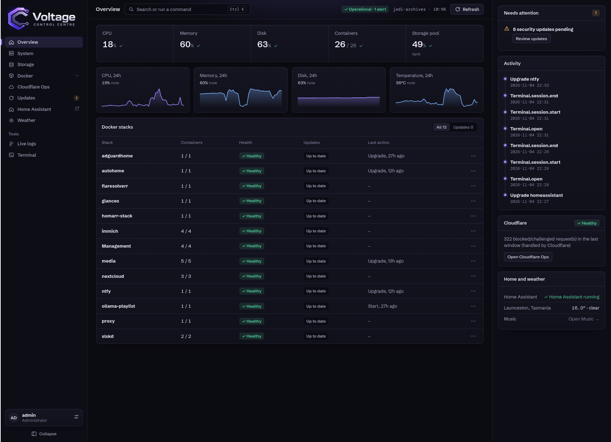

# Engineering Journal

Engineering journal documenting hands-on Linux systems administration, homelab infrastructure, Docker, networking, security, monitoring, automation and AI-assisted tooling.

## About

I'm TJ, a self-employed IT technician running [Voltage PC Repairs](https://voltagepcrepairs.com.au) in Australia. My interest is Linux, infrastructure and DevOps, and I learn by running real systems: a Docker-based homelab that supports my business tooling and my family's everyday services.

This repository is where I write that work down: what I built or changed, why, what broke and what I learned. Sensitive details (addresses, credentials, customer information, exact firewall and port layouts) are deliberately left out. See the [publication guide](PUBLICATION-GUIDE.md).

**How I work.** Some project code and tooling were developed with AI-assisted coding tools (Claude). I'm responsible for requirements, architecture, deployment, testing, validation, security decisions and ongoing operation. I'm not presenting myself as a software developer, though one small project, the [CD backup script](projects/cd-backup.md), is mostly my own Python. I prefer plain, simple interfaces, and I build and set things up so that people who are not into computers can use them. The strength of this repo is the systems work around the code.

**Not a tech person?** Every journal entry opens with an "In short" box in plain English, and the [glossary](GLOSSARY.md) explains the technical words.

## If you only have 5 minutes, start here

1. [Control Centre](projects/control-centre.md): the dashboard I run the whole lab from, and the project I am proudest of.
2. [Homelab overview](infrastructure/homelab.md): what runs, how it's laid out, and the principles behind it.
3. [Internal reverse proxy](infrastructure/reverse-proxy.md): reaching services by name instead of by address and port.
4. [Retiring Portainer and hardening network exposure](journal/2026/2026-10-04.md): a day of audit-then-harden work (SSH, firewall, logins, closing ports).
5. [Signing key committed to version control](security/incident-response.md): an incident case study, from detection to rotation to prevention.
6. Latest entry: see the [journal index](journal/README.md).

## What this repo contains

| Section | What's in it |
| --- | --- |
| [`journal/`](journal/README.md) | Dated engineering logs: changes, debugging, decisions, lessons |
| [`projects/`](projects/README.md) | Project write-ups, each with an explicit "my role" section |
| [`infrastructure/`](infrastructure/README.md) | Architecture and platform notes: homelab, Docker, reverse proxy, monitoring |
| [`security/`](security/README.md) | Hardening notes and incident write-ups |
| [`repairs/`](repairs/README.md) | Hardware repair and diagnostic case studies (planned) |
| [`GLOSSARY.md`](GLOSSARY.md) | Plain-English explanations of the technical terms |

## Featured work

**Control Centre.** The tool that makes a large Docker and server stack manageable. One dashboard shows every stack, host health, security and update status, and lets me restart or upgrade a single container safely with protection levels, health checks and a one-time undo. It is the project I use most and have put the most thought into. The code was largely written with AI assistance. *What I did:* defined the problem, designed what it shows and what it may do, tested every change against the real lab, and run it daily. [Control Centre](projects/control-centre.md), [how it grew](journal/2026/2026-10-09.md).



**Homelab and reverse proxy.** One Docker host running Compose stacks defined in version control, with internal services reached by name through a private Caddy proxy over LAN and Tailscale. A few services are published through Cloudflare Tunnel instead of port forwards. *What I did:* designed the layout, deployed and migrated the services, and wrote the migration order and rollback steps. [Homelab](infrastructure/homelab.md), [Reverse proxy](infrastructure/reverse-proxy.md).

**Security hardening and exposure audit.** Audited what the server really listens on, then moved SSH to key-only with fail2ban, narrowed firewall rules, put logins and TLS on admin tools, and closed direct ports. *What I did:* chose the method (repoint first, close second), tested every change from a fresh connection, and verified the apps still worked. [Journal, 04/10/2026](journal/2026/2026-10-04.md), [Hardening](security/hardening.md).

**Incident response.** A private key reached a git repository through a backup folder. I contained it, rotated it, debugged two configuration failures and added a fail-closed secret-scanning hook. [Case study](security/incident-response.md).

**Monitoring.** Uptime Kuma, Dozzle, a UPS dashboard and self-hosted ntfy notifications, kept in step with every service move. [Monitoring](infrastructure/monitoring.md).


**CD Backup Script.** A Python tool that copies old data discs to server storage, with dry runs, clean failure handling and an optional full-screen interface. This is the one project here where I wrote most of the core code myself, as a way to learn Python. [CD Backup Script](projects/cd-backup.md).

**Business websites.** Two small business sites (my repair business and a photography business) deployed from Git to Cloudflare Pages, with a contact form hardened by Turnstile, rate limiting and a honeypot. I built the first version of the photography site myself; the later redesign and the other sites' code were largely AI-assisted. The setup, security and operation are mine. [Business websites](projects/business-websites.md), [the deploy that failed quietly](journal/2026/2026-10-12.md).

**Voltage Business Portal and VoltOps.** One front door for the repair business: a small website that brings the repair app, software licences and server status together, with a limited login for a helper. VoltOps moved from my desktop onto the server in a rehearsed, written-down switch. *What I did:* decided what the portal shows and may do, planned and ran the switch, and operate it. [Voltage Business Portal](projects/voltage-business-portal.md), [VoltOps](projects/volt-ops.md), [the switch](journal/2026/2026-10-30.md).

**Voltage Music.** The music player, moved out of the Control Centre into its own app so a fault in one cannot reach the other. The server now plays the music itself, gapless, through a Bluetooth adapter. [Voltage Music](projects/voltage-music.md), [the split](journal/2026/2026-10-31.md).

**Other projects.** [VoltOS](projects/voltos.md), [Holocron Kiosk](projects/holocron-kiosk.md) (retired).

## Skills demonstrated

Only things evidenced in this repo.

- **Linux / systems:** administration, systemd, SSH hardening, fail2ban, firewall rule review and cleanup, host and UPS monitoring.
- **Linux desktop:** Fedora (dnf) with Xfce, earlier Arch-based systems, KDE Plasma, GNOME and Hyprland, a documented rebuild order and a package list kept in step with the machine.
- **Docker / containers:** Compose stacks as code, container networks for isolation, log rotation, scoped automatic updates with Watchtower, image and volume cleanup.
- **Networking:** reverse proxying with Caddy, wildcard internal DNS, Tailscale, Cloudflare Tunnel, how Docker-published ports interact with the host firewall.
- **Security:** attack-surface audit, authentication on admin tools, TLS, least-privilege accounts, secrets handling, incident response and key rotation.
- **Monitoring:** Uptime Kuma, Dozzle, ntfy, noise reduction, monitoring as part of change management.
- **Python scripting:** a command-line tool with batch handling, error clean-up and a tested permission rule, written mostly by me as a learning project.
- **Web hosting and deployment:** static sites on Cloudflare Pages deployed from Git, Pages Functions, Turnstile, KV rate limiting, DNS and email-domain verification.
- **Automation:** opt-in update policy, pre-commit secret scanning, README-driven rebuildable setups.
- **Git and documentation:** version-controlled infrastructure, sanitised public write-ups, structured journal entries.
- **AI-assisted workflow:** specifying requirements, reviewing and testing AI-generated changes, and keeping responsibility for what runs.

## Journal

Latest entries (full list in the [journal index](journal/README.md)):

- 05/11/2026: [Bash script for keeping Git repositorys in sync](journal/2026/2026-11-05-git-sync.md)
- 05/11/2026: [Automated Torrent Seedbox with Safe Manual Import Gate](journal/2026/2026-11-05-linux-torrents.md)
- 01/11/2026: [Clean-up day, and the Bluetooth that dropped when I turned off my computer](journal/2026/2026-11-01.md)
- 31/10/2026: [Giving the music app its own home](journal/2026/2026-10-31.md)
- 30/10/2026: [A business portal, and moving VoltOps onto the server](journal/2026/2026-10-30.md)
- 27/10/2026: [A new look for the Control Centre, and a terminal in the browser](journal/2026/2026-10-27.md)
- 23/10/2026: [Cleaning up a Fedora Xfce workstation without breaking the themes](journal/2026/2026-10-23-fedora-cleanup.md)
- 23/10/2026: [An Unwanted Tech page, reusing the form defences](journal/2026/2026-10-23-unwanted-tech.md)

## Current learning

- DevOps practice: CI/CD, infrastructure automation
- Linux certification preparation
- Kubernetes, later, once the Docker fundamentals feel solid

## Links

- GitHub: [VoltageViper99](https://github.com/VoltageViper99)
- Business: [Voltage PC Repairs](https://voltagepcrepairs.com.au)

## Working on this repo

This is a public repo of Markdown, images and a commit hook. There is nothing to build or run.

**One-time setup per clone** (details in the [publication guide](PUBLICATION-GUIDE.md)):

1. Install [gitleaks](https://github.com/gitleaks/gitleaks#installing) (v8.30.0 on this machine).
2. Turn on the tracked hook: `git config core.hooksPath .githooks`. Check with `git config --get core.hooksPath`.

The hook scans staged changes for secrets plus private/Tailscale IPs and `.ts.net` hostnames, and **refuses the commit if gitleaks isn't
installed**. Full history scan any time: `gitleaks git --redact --config .gitleaks.toml`.

**Adding a journal entry:**

1. Create `journal/2026/YYYY-MM-DD.md` (or `YYYY-MM-DD-topic.md` if there are several that day) with the front matter from the
   publication guide, a "Back to journal index" link, and an "In short" box.
2. Add a row to the table in `journal/README.md` and to "Latest entries" above.
3. Check images against the list in `assets/README.md`, then read `git diff --staged` before committing.

**Check for broken relative links** (read-only; run from the repo root):

```bash
python3 -B - <<'PY'
import re, os, glob
for f in glob.glob('**/*.md', recursive=True):
    for m in re.finditer(r'\]\(([^)#\s]+)(#[^)]*)?\)', open(f).read()):
        l = m.group(1)
        if not l.startswith(('http', 'mailto')) and not os.path.exists(os.path.normpath(os.path.join(os.path.dirname(f), l))):
            print(f, '->', l)
PY
```

(As of 2026-11-03 the only hit is the example link inside a code block in `PUBLICATION-GUIDE.md`, which is fine.)

## Troubleshooting

**Commit refused: "gitleaks is not installed"**
The hook fails closed on purpose. Install gitleaks (`which gitleaks` to check), then retry. Don't use `--no-verify` on this public repo.

**Commit refused with a finding**
The hook prints a redacted match with file and line. Fix the content: describe roles instead of addresses (see the publication guide's
sanitising table). If it's a genuine false positive, add a narrow allowlist entry (path plus pattern, with a comment) to
`.gitleaks.toml`; don't disable rules. Commonly triggered by example IPs like `192.168.x.x` or `100.64-127.x.x` in text, and by
anything ending `.ts.net`.

**The hook isn't running at all (commits go through unscanned)**
Check `git config --get core.hooksPath`. It should print `.githooks`. It's a per-clone setting, so a fresh clone has it unset: re-run step 2 above. Also check
`.githooks/pre-commit` is executable (`ls -l .githooks/pre-commit`).

**gitleaks complains about unknown command `git` or `--staged`**
Old gitleaks. The hook already falls back to `gitleaks protect --staged` for versions before 8.19; if both fail, update gitleaks.

**GitHub won't render a page, or shows the front matter as text**
The front matter YAML is invalid (an earlier commit, "Fix front matter that GitHub could not parse", was this). Check the `---` fences
are the first and last lines of the block, strings with a colon are quoted, and `tags:` is a list.

**A page is marked `public: false` but I committed it**
It's still public. That flag only marks a draft for a possible future website feed; see the warning in the publication guide. If it
contained something sensitive: rotate the secret first, then deal with history.

**A new entry is missing from the index**
The index (`journal/README.md`) and "Latest entries" above are edited by hand, so nothing updates them. Add the entry to both.

## Licence

Text is licensed under [CC BY 4.0](LICENSE). Pages carry front matter (`title`, `date`, `category`, `tags`, `summary`, `public`, `featured`) so a feed can be built from them later.
