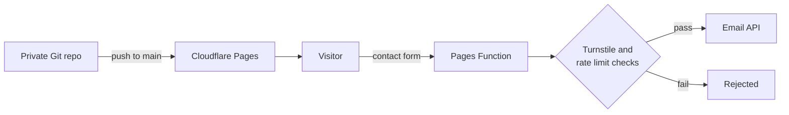

[Back to projects](README.md)

## Summary

Three public websites that I run and deploy:

| Site | What it is |
| --- | --- |
| [Voltage PC Repairs](https://voltagepcrepairs.com.au) | My repair business: services, pricing, online booking and a contact form |
| FoxWhitty Photography | A photography business: filterable photo archive, prints information and a contact form |
| [Supporter Invoicing](https://supporterinvoicing.com.au) | The product site for the [invoicing app](supporter-invoicing.md), including the on-site purchase flow |

All three are plain HTML, CSS and JavaScript with no framework and no build step. Each lives in a private Git repository and is served by Cloudflare. The source is private; this page is about how they are built, deployed and protected.

## Problem

A small business needs a site that is fast, cheap to run, easy to change and hard to abuse. I did not want a CMS to patch, a server to maintain or a monthly hosting bill for what is mostly static content. The only dynamic parts are forms, booking and (for the product site) buying, so those are the parts that need real care.

## Architecture

- **Static pages:** hand-written HTML, CSS and a little JavaScript. No dependencies to patch.
- **Deploy from Git:** pushing to `main` deploys automatically through Cloudflare Pages. One site (the photography one) uses Cloudflare's static-assets deploy instead.
- **Server-side only where needed:** the repair business contact form and the product site's purchase steps run as small Cloudflare Pages Functions, so keys never reach the browser.
- **Booking:** an embedded scheduling calendar synced to a calendar, so availability is real.
- **Data-driven gallery:** the photography site reads every photo from one data file, so adding a photo means one entry and two image files.
- **Email and DNS:** DNS is on Cloudflare, with the sending domain verified for the email service (SPF and DKIM) so contact-form mail is trusted.

## Technologies

Cloudflare Pages and Pages Functions, Cloudflare Turnstile, Cloudflare KV (for rate limiting), Wrangler, Git and GitHub, HTML, CSS and JavaScript, a transactional email API, an embedded booking calendar and Web3Forms (photography site forms).

## My role

I run all three sites: the domains and DNS, the Cloudflare setup, the secrets, the deploys and the content. I decided what each site should say and offer, tested the forms and booking end to end, and handled the security and the fixes.

The page code was largely written with AI assistance (Claude), and I am not presenting it as hand-written. Where I have not verified who wrote what, I have not claimed it.

## Key decisions

- **Static first.** Nothing to patch, nothing to crash, near-zero running cost. Server code exists only where a form needs it.
- **Keep secrets out of the repository.** API keys live as Cloudflare secrets and in a gitignored file for local testing. Plain settings sit in the config file; secrets never do.
- **Say what is actually offered.** In October I replaced a "software development" service page on the repair site with an "Engineering" page, to describe the work more accurately.
- **Rebuild a lost site from production** rather than rewrite it (see below).

## Security considerations

The contact form sends an automatic confirmation to whatever address a visitor types in, which is exactly what a spam bot wants to abuse. After a spam submission in late September I added layers, so that no single one has to be perfect:

- A hidden **honeypot** field. A bot that fills it gets a normal-looking success reply and no email is sent.
- **Server-side validation** of the email format and field lengths, whatever the browser did.
- **Cloudflare Turnstile**, verified on the server. The Turnstile widget is shared across my sites, so the function also checks which hostname the token was solved on. A token earned on one site cannot be replayed against another.
- **Per-IP rate limiting** using a Cloudflare KV store, with a specific "too many messages" reply for legitimate people who hit the limit.
- The checks **fail closed**: if the Turnstile secret or hostname list is missing, the request is rejected rather than allowed.

The product site's purchase steps keep the payment secret key off the website entirely. Only the publishable key (designed to be public) is in the page, and the rest is handled by the backend described in [Supporter Invoicing](supporter-invoicing.md).

## Testing and validation

- Ran the site and its function locally with Wrangler, including a real Turnstile solve, and confirmed both emails arrived.
- Re-tested on the live domain from a phone on mobile data, so the test did not trip my own rate limit.
- Compared the live repair site with its repository after the DNS move. The only differences were scripts Cloudflare injects at delivery.
- Had the product site's purchase flow code-reviewed before merging, which found five issues that were fixed first.

## Problems encountered

- **Hardening that was not live.** I added the contact-form protections on 30/09, but every deploy after that failed because the config file still held a placeholder instead of the real KV namespace id. The static pages published, the functions did not, so the old unprotected form kept serving until I fixed it on 08/10. Nothing alerted me, and I only found it while verifying end to end. Details in the [journal entry](../journal/2026/2026-10-12.md).
- **A site with no source.** The product site's original source had been lost with no backup. I mirrored the live site, undid the offline-mirror changes to links and canonical tags, removed the scripts Cloudflare injects, and committed that as the new source of truth.
- **Settings that did not reach the function.** With a config file present, plain variables set in the dashboard were not reliably passed to the function, so they now live in the file and only secrets are in the dashboard.
- **Copy-pasted navigation.** The photography site has no templating, so a menu change means editing every page. Fine for five pages; it would not scale.

## Current status

All three sites are live. The repair and product sites are deployed from Git on every push to `main`. The photography site is a finished, simple site with Cloudflare logging switched on.

Next: set the contact-form secrets for preview deployments (deliberately left off so far), and add a deploy-failure alert so a broken deploy is noticed on the day.

## Lessons learned

- A successful commit is not a successful deploy. Verify the live behaviour after a security change, not just the code.
- Layered, fail-closed checks suit a public form better than one clever filter.
- Treat a shared widget like a shared key: scope where it is accepted.
- Recovering from production works, but only because the site was static. Keep source in Git from day one.
- Configuration files can quietly override the dashboard. Know which one wins.
