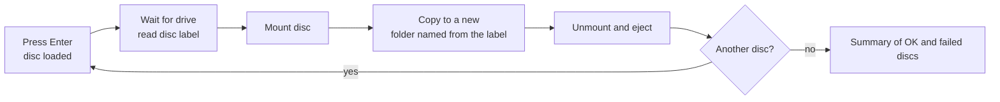

[Back to projects](README.md)

## Summary

A command-line tool that copies the files from old data CDs and DVDs (1990s and 2000s games, programs and other data) into a folder on my Linux server, using the server's disc drive. It is a plain file copy, not a disc image, and most of the discs are just folders. It is also my first real Python project, so I wrote most of the core myself to learn the language.

## Problem

I had a pile of old discs that were slowly degrading and a server with a drive and plenty of storage. Doing each disc by hand (mount, copy, check, unmount, eject) is tedious and easy to get wrong, and a half-finished copy or a disc left mounted causes trouble for the next one.

## Architecture

- **One script runs the whole job:** it reads the disc label, mounts the disc, copies it, then always unmounts and ejects, even if the copy failed, so the tray opens for the next disc.
- **Batch loop:** after each disc it asks whether there is another. A failed disc does not stop the batch, and a summary is printed at the end.
- **Optional full-screen version:** a text interface (built on the Textual library) draws the same engine's progress. The backup logic is not duplicated; the screen only reacts to it.
- **Optional sound effects:** a small player on my desktop plays short 8-bit sounds for events such as a disc being found or a copy finishing. The server sends one-word messages to it over an SSH reverse tunnel. If the player is not running, the backup works the same and is just silent.

## Technologies

Python 3 (standard library for the core), the Linux tools `lsblk`, `udisksctl` and `eject`, polkit, SSH, and Textual for the optional interface.

## My role

- Chose the problem, the workflow and the safety behaviour: dry run by default, never overwrite an existing folder, always eject, never leave a partial copy behind.
- **Wrote roughly 85% of the core script myself:** reading the label, mounting, the copy, unique folder names, the retry and batch loop, and the error handling around them. I learned Python by building it, and the project includes a plain-English notes file on the syntax I met along the way.
- **AI-assisted:** Claude wrote the remainder of the core script and added the live progress display, the full-screen interface and the sound effects. I specified those, tested them on a real disc and reviewed the changes.
- Set up the one-time system permission rule so the script can mount the drive over SSH, and tested it.
- Tested end to end with a real disc and fixed what broke.

## Key decisions

- **Dry run by default.** Nothing is created, copied or ejected without `--apply`.
- **Never overwrite.** If a folder for that label exists, a number is appended instead.
- **Wait for me, then look for the disc.** The script waits until I press Enter, then allows up to 30 seconds for the drive to spin up, so I have time to load the tray.
- **Clean up on failure.** A failed copy removes its half-finished folder, so a retry gets the normal folder name.
- **A failed disc does not stop the batch.** It is recorded, and the exit code is non-zero if any disc failed.
- **Skip unreadable files, record them.** Root-only files on Linux discs are skipped and listed in a text file in the copy, instead of failing the whole disc.
- **A narrow permission rule, not a blanket one.** See below.

## Security considerations

- Mounting over SSH normally asks for an administrator password, which would block the batch loop. Rather than run the script as root, I added a small polkit rule that lets members of the optical-drive group mount that one drive without a password. It does not touch other disks, and removing the rule file rolls it back.
- Disc contents are untrusted. The script only copies files and never runs anything from a disc.
- Limitation: the copy is not yet verified against the disc.

## Testing and validation

- Dry run first, then real discs, end to end on the server.
- Failure handling covers an empty drive, copy errors and Linux discs with root-only files and broken shortcuts.
- There is no automated test suite. Hardware is the hard part to test, and that is a known gap.

## Problems encountered

- **A password prompt over SSH.** Mounting worked at the machine but asked for a password remotely. The logs showed the policy rule involved, which led to the narrow rule above.
- **Input prompts that looped.** The "another disc?" prompt needed fixing twice before it behaved.
- **Half-finished copies.** A failed copy could leave a partial folder behind, which then forced the next try onto a numbered name. Removing it on failure fixed that.
- **Linux discs.** Root-only files and broken shortcuts would otherwise fail a whole disc, which led to the skip-and-record approach.

## Current status

Working, and tested end to end with a real disc. Not done yet: a free-space check, checking the destination is writable before mounting, verifying the copy (file count and size against the disc) and tidying odd characters out of disc labels.

## Lessons learned

- Build it in small steps and test each on real hardware: skeleton, mount, copy, eject, loop.
- Decide what must happen on failure before writing the happy path.
- Keep the engine separate from the screen, so a new interface does not mean rewriting the logic.
- Writing the code myself taught me far more about Python than reviewing generated code would have, and I now read the AI-written parts with better judgement.

See the [journal entry](../journal/2026/2026-10-10.md) for how it was built.
