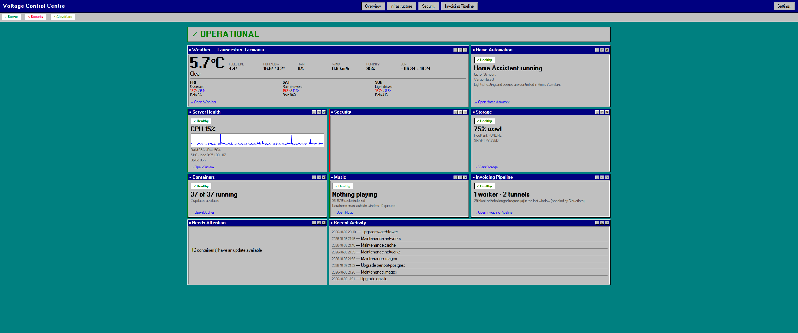
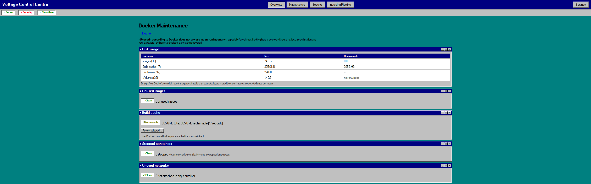

[Back to projects](README.md)

## Summary

Control Centre (formerly "Holocron") is the single place I run my homelab from. It groups every Docker stack automatically, shows host health, security and update status, tracks the Cloudflare-backed invoicing pipeline, lets me act on containers safely and doubles as a remote for my music library. A native display client, the [Holocron Kiosk](holocron-kiosk.md), shows it on a wall screen.

It is the most important tool I have built for the lab, and the one I use every day. The code was written largely with AI assistance. The problem it solves, and every decision about how it behaves, are mine.

## Problem

A couple of dozen containers across many stacks meant a pile of separate admin pages, remembered ports and overlapping dashboards. Nothing answered the question I actually ask each day: is everything healthy, is anything insecure or out of date, and what needs my attention? I wanted one place that answers that at a glance, lets me act on it safely, and keeps itself correct as stacks come and go.

## What it does

- **Overview:** one status-first page with an overall verdict, then cards for server health, security, storage, containers, music and the invoicing pipeline, followed by "Needs attention" and recent activity. Each card shows Healthy, Warning, Critical or Unknown as text plus a symbol, never colour alone, and a missing source shows "Unknown" instead of breaking the page.
- **Automatic grouping:** containers are grouped by their Compose project label, so there is no service list to maintain as stacks change.
- **Containers and system:** logs and history charts per container, and CPU, memory, disk, network, temperature, UPS, storage health and systemd status for the host.
- **Updates:** pending operating system security updates and reboot-required status, shown as an amber warning (never critical) on the overview. The page used to be a Security page built around vulnerability scans; see the limitations below.
- **Actions:** start, stop and restart a single container, and upgrade one with a check that it came back healthy and a one-time undo. Both are opt-in and limited by protection levels.
- **Docker maintenance:** shows unused images, build cache, stopped containers and networks, and never deletes anything without review and confirmation.
- **Cloudflare operations:** Worker analytics and tunnel status for the invoicing pipeline.
- **Music:** a remote control for a self-hosted library, now its own separate app so a problem there cannot affect the dashboard.

## Architecture

- A Flask and SQLite web service running as a systemd service on the lab host.
- One background poller per integration (Docker, system metrics, systemd, ZFS and SMART, UPS, weather, Cloudflare, a music server and others), each on its own schedule with its own error handling. A hung integration shows as a marked state and never blocks another poller or a page load.
- The service reads Docker through the local socket, so there is no SSH hop or agent between display and server.
- Vulnerability scanning was built (Trivy, with known-CVE lookups) and then removed on 12/10/2026. The page now reports only pending updates and reboots.
- SQLite keeps metric history for charts. Pages are served from the database plus an in-memory latest snapshot.

## Screenshots

*The overview page. The security panel is blanked out in this public copy.*

*Docker maintenance. It reports what could be cleaned up but never deletes anything without review and a confirmation. Cropped to the summary panels.*

## How it grew

The major steps, newest last. Dates are from the project history.

- **04/08/2026:** first published version, a single-screen app with a separate agent collecting data over SSH.
- **September:** rewrite to a Flask and SQLite web service with one poller per integration, paired with a native PySide6 kiosk client and a test suite. The old browser kiosk and SSH data path were dropped.
- **22/09/2026:** login and API keys added, so nothing browser-facing is open by default.
- **26/09/2026:** safe container actions, with protection levels enforced on the server.
- **Early October:** a container upgrade action that verifies health afterwards and can be undone once, and a single-page kiosk redesign.
- **05/10/2026:** music grew smart playlists and automatic loudness levelling. It now runs as its own app.
- **06/10/2026:** the big consolidation day. The overview became an operations hub, and the Security, Cloudflare and Docker maintenance pages arrived. CSRF protection was added to every state-changing request.
- **07/10/2026 onwards:** a Settings page, session handling consolidated, dead code removed and duplicated helpers merged, Bluetooth auto-reconnect for the kiosk, CPU temperature and security status improvements.

See the [journal entry](../journal/2026/2026-10-09.md) for the story behind these.

## Technologies

Python, Flask, SQLite, waitress, systemd, Docker Engine API, Cloudflare API, a PySide6 client, pytest.

## My role

- Defined what the dashboard had to show and which tools it should replace (Homarr and other overlapping dashboards).
- Chose the architecture, including isolated pollers and the move from a browser-based kiosk to a native client.
- Deployed and operate it, and updated its links as services moved behind the [reverse proxy](../infrastructure/reverse-proxy.md).
- Tested and debugged it in daily use and decided how it is exposed.
- Decided what each page and action should do, how risky actions are limited and what counts as healthy or critical.
- Ran it against the real lab through each change, found what was wrong or confusing and sent it back.
- **AI-assisted development:** most of the code was written with Claude. I specified the behaviour, reviewed and tested it on the real lab and made the design calls. I did not write it myself, and I am not presenting it as my own code. What I own is the problem, the design and the operation.

## Key decisions

- **Isolated pollers.** A flaky external API must not freeze the rest of the dashboard.
- **Native client over a browser kiosk.** A Chromium kiosk brought a class of problems (reserved shortcuts, context menus, quirks from cheap remotes) that a plain Qt window does not have.
- **Opt-in, tiered actions.** Container actions are off until enabled and limited by protection levels (normal, protected, critical) enforced on the server. They apply to one container at a time, with no stack-wide actions and no way to create or remove containers.
- **Log before enforcing.** Permission tiers for API keys started in a log-only mode, so I could check real traffic against them before anything was denied.
- **Keep secrets out of config.** Preferences live in one file and secrets in a separate restricted environment file, checked when the service starts.
- **Split music out.** Its own process, session and workers, so it cannot take the dashboard down.
- **Replace, don't add.** Homarr was removed once this covered what I used it for. Fewer dashboards means fewer things to keep correct.

## Security considerations

- Internal use only, over LAN and Tailscale. It is not published to the internet.
- Every page needs a login. The kiosk's data endpoint is the one open route, and it is reachable from the private network only. Sessions expire after ten minutes idle.
- Every state-changing request is checked against a per-session CSRF token, so a malicious web page cannot make my logged-in browser act on the dashboard.
- It can see container state, so it is treated as an administrative interface and reached through the private proxy.
- Limitation: it runs on the same host it monitors, so a whole-host outage takes it down too.

## Testing and validation

- The project repo has a pytest suite. Beyond that I rely on daily use against the real stack, and I check links and monitors after each service migration.
- New features go in on their own branches and are merged once they work on the real lab, which is why the history shows many small merges.

## Problems encountered

- Renaming the app changed the HTTP user agent and the client name sent to the music server, which then showed a new player entry. Harmless, but a reminder that a display rename can be visible to other software.
- Internal package and service names still carry the old Holocron name for compatibility. Migrating them is a separate, later job.

## Current status

In daily use and under active development. Known next steps: a proper phone layout, backup status on the overview and a Home Assistant quick-controls card.

## Lessons learned

- Give every integration its own failure state, so one dead dependency cannot take the page down.
- Split a feature out when its failures should not affect the rest. Music was the first.
- Make risky actions opt-in, narrow and reversible, and log before enforcing a new rule.
- After any service move, repoint the dashboard links and the monitors before calling it finished.
